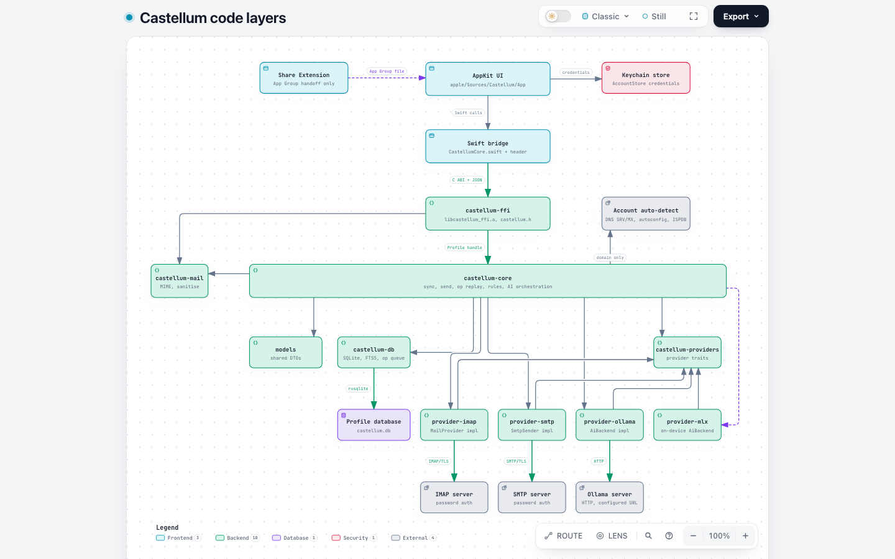

# Castellum

Castellum is an email client for macOS. It keeps your mail, and any AI that reads it, on your own Mac.

It syncs mail over standard IMAP and SMTP into a local SQLite database with full-text search. Optional
AI features (summaries, triage, drafts) use a model server you run yourself, such as
[Ollama](https://ollama.com). The core is written in Rust; the app is native Swift and AppKit.

## Status

Castellum is **pre-1.0 software**. Expect rough edges and breaking changes, and keep a backup of any mail that matters (your server copy is the backup: Castellum
is an IMAP client, not an archive).

What works today:

- IMAP accounts with an app password. Presets for Gmail, iCloud, Fastmail and Yahoo; other providers
  through auto-detection or manual settings.
- Sync, reading, search, compose, reply and forward, send with undo and send later, snooze, rules,
  signatures and templates, keyboard-first navigation.
- New accounts start read-only. Castellum does not move, delete or send from an account until you
  turn writing on for it.
- Optional local AI through Ollama.

What does not work yet:

- Outlook and Microsoft 365 accounts. They need OAuth sign-in, which is not built yet.
- Sign-in with Google (OAuth). Gmail works with an app password only.
- Unsigned builds (see below) cannot use the Share Extension; it needs a signed build.
- No Mac App Store version. macOS 13 or later.

Bugs and gaps are tracked in this repository's issues.

## Install

Download the DMG from the [Releases](../../releases) page. Each release lists its SHA-256 checksum.
Builds are universal (Apple silicon and Intel).

Check the download before opening it:

```bash
shasum -a 256 ~/Downloads/Castellum-*.dmg   # compare with the release's SHA256SUMS file
```

Open the DMG and drag Castellum to Applications.

### Opening an unsigned build

A release named `Castellum-<version>-unsigned.dmg` is built by GitHub Actions without an Apple
Developer ID and is not notarised by Apple. macOS blocks it the first time ("cannot be opened" or
"Apple could not verify"). If you trust the download and its checksum, do one of these once:

- In Terminal: `xattr -dr com.apple.quarantine /Applications/Castellum.app`, then open the app.
- Or open the app once, then go to System Settings > Privacy & Security, find the message about
  Castellum and click "Open Anyway".

A file named `Castellum-<version>.dmg` (without `-unsigned`) is signed and notarised and opens normally.

## Build from source

You need macOS with Xcode and its command line tools, Rust from [rustup](https://rustup.rs), and
[XcodeGen](https://github.com/yonaskolb/XcodeGen) (`brew install xcodegen`).

```bash
# Rust core: format, lint, test
cargo fmt --all --check --manifest-path native/Cargo.toml
cargo clippy --all-targets --manifest-path native/Cargo.toml -- -D warnings
cargo test --manifest-path native/Cargo.toml

# macOS app
scripts/build-macos.sh test        # Swift unit tests, unsigned
scripts/build-macos.sh build       # Debug app "Castellum Dev", ad-hoc signed, no Apple account needed
scripts/build-macos.sh app-path    # prints where Castellum.app was built

# The release DMG, exactly as the release workflow builds it
scripts/release-build.sh --version 0.4.0 --out dist
```

`release-build.sh` makes an unsigned DMG unless a Developer ID certificate and Apple notarisation
credentials are present (see the header of `.github/workflows/release.yml`).

Some end-to-end tests use a local [GreenMail](https://greenmail-mail-test.github.io/greenmail/) server
in Docker. See [CONTRIBUTING.md](CONTRIBUTING.md) and [`native/README.md`](native/README.md).

## How it is built

```
native/   Rust workspace: sync, storage, search, operation queue, AI providers, C ABI (castellum-ffi)
apple/    Swift/AppKit app (XcodeGen spec: apple/project.yml)
scripts/  build, UI checks, local GreenMail test server
docs/     architecture diagram
```

Rust owns all durable state and exposes a narrow C interface; Swift owns windows and presentation.
A malformed server response becomes an error, not a crash: the IMAP layer uses a typed decoder.



## Privacy

- Mail is stored in a local database on your Mac. Passwords are stored in the macOS Keychain.
- Castellum connects to your mail servers (IMAP and SMTP over TLS) and to the AI endpoint you set.
  The only other requests are:
  - account auto-detection when you add an account (only the domain is sent; can be turned off);
  - an update check against the GitHub releases API, daily by default (Settings > General > Updates
    can set it to "Never");
  - licence activation with Lemon Squeezy, only when you enter or remove a licence key;
  - remote images, only when you allow them;
  - a one-click unsubscribe request, only when you choose Unsubscribe.
- No account with us, no analytics, no tracking.
- AI is optional. The code has no cloud AI endpoints. Castellum only talks to a model server on a
  private or loopback address and refuses any endpoint that resolves to a public address. If Ollama
  is running on your Mac at first launch, Castellum turns AI on and points it there; you can turn it
  off in Settings.

Found a security or privacy problem? See [SECURITY.md](SECURITY.md).

## Licence

Castellum is free for noncommercial use under the
[PolyForm Noncommercial License 1.0.0](LICENSE). Keep the notice in [NOTICE](NOTICE)
(Copyright 2026 Riera Technologies Ltd) when you pass it on.

Commercial use needs a paid licence from Riera Technologies Ltd: see [COMMERCIAL.md](COMMERCIAL.md).

Contributions are welcome: read [CONTRIBUTING.md](CONTRIBUTING.md) and the
[Code of Conduct](CODE_OF_CONDUCT.md) first.
